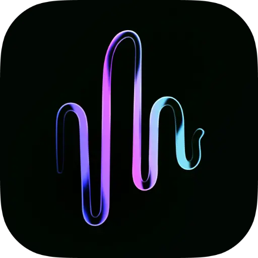

  

<h1 align="center">NotchLive</h1>

<strong>Local live captions, translation, meeting intelligence, and agent-ready context for macOS.</strong>

Capture app audio, your microphone, or both. Follow conversations live, turn meetings into useful records, and share only the context you choose with your AI tools.

  
  
  
  
  

  <a href="https://github.com/lemberalla/notchlive-releases/releases/latest"><strong>Download</strong></a>
  · <a href="https://notchlive.app">Website</a>
  · <a href="https://notchlive.app/how-to-use">How to use</a>
  · <a href="https://notchlive.app/privacy">Privacy</a>

---

NotchLive turns your MacBook notch—or the top center of any Mac display—into a private, on-device conversation workspace. Captions stay useful after the moment has passed: as a searchable Timeline, a reviewed meeting record, an on-device summary, or carefully permissioned context for an AI agent.

## Follow any conversation live

- Caption **Apps & Media**, **My Voice**, or **Everything** together.
- Switch between a compact **Focus** view and a searchable, scrollable **Timeline** with separate system-audio and microphone lanes.
- Detect the spoken language automatically, or choose from a searchable picker covering 90+ Whisper-supported languages.
- Choose from six local speech models: Tiny, Base, Small, Medium, Large v3 Compact, and Large v3.
- Translate captions locally into 20 supported languages on macOS 15 or later.
- Copy or export completed captions, resize the text, keep the floating display above other windows, and control NotchLive with global shortcuts.
- Use NotchLive on Macs with or without a physical notch.

## Turn meetings into useful records

- Explicitly record caption sessions as local transcripts—NotchLive does not record meeting audio.
- Browse and search saved sessions, then switch between original **Raw** and refined **Clean** transcripts.
- On Apple-silicon Macs, attribute remote speakers locally and review the result before treating names as confirmed.
- Rename, merge, reassign, split, or remove transcript turns with reversible participant-review tools.
- Explore deterministic **Meeting Analytics** for words, turns, speaking time, conversation share, and attribution coverage.
- Generate on-device **Meeting Intelligence** with summaries, current focus, key moments, open questions, and action items on supported Macs.
- Copy, share, or export TXT, Markdown, and JSON; auto-export to a chosen folder; and move local NotchLive data through export/import bundles.

## Give agents context—not authority

NotchLive Pro includes a signed, headless, local MCP helper for read-only meeting context.

- Connect Codex or Claude Desktop with guided setup, or copy standard stdio configuration for another MCP-capable client.
- Let a configured client request saved meetings, reviewed transcripts, participant provenance, Meeting Analytics, Voice Notes, and finalized updates from an active Timeline.
- Control saved-data access and live-caption access separately.
- Partial captions and raw audio are never exposed through MCP.
- NotchLive provides no MCP tools for starting recordings, controlling the microphone, editing files, sending messages, deploying software, or performing other external actions.

MCP access is off by default. The connected AI client—not NotchLive—decides which model receives requested context and what actions require your approval.

## Capture thoughts with Voice Notes

Dictate a note, preserve the raw text, clean it up locally, translate it, save or export it, and send it to NotchPad when both apps are installed.

## Built for real Mac workflows

- **Kōkako** uses local echo-reference processing to reduce speaker playback entering microphone captions, monitors that reference path, and can rebuild or use a session-only compatibility path when unhealthy.
- Optional inactivity sleep releases capture resources after a quiet period without interrupting recordings or Voice Notes.
- Sleep/wake recovery suspends capture while macOS sleeps and rebuilds fresh audio pipelines after wake.
- Speech-model verification and **Repair** can replace an incomplete or unhealthy model download.
- Meeting detection can ask before recording when NotchLive recognizes a likely call.
- **Ghost Mode** can keep captions running while excluding NotchLive windows from screen sharing and screen recordings.
- Experimental, ASL-inspired **Sign Cues** can surface conversational signals such as questions, hand-offs, action items, and requests to slow down. They are not sign-language translation.
- The interface is localized into English plus 19 additional languages.

## Free and Pro

| Capability | Free | Pro |
|---|:---:|:---:|
| Local live captions and all speech models | ✓ | ✓ |
| Apps & Media, My Voice, and Everything capture | ✓ | ✓ |
| Focus and Timeline views | ✓ | ✓ |
| Local translation | — | ✓ |
| Voice Notes | — | ✓ |
| Saved sessions, participant review, and exports | — | ✓ |
| Meeting Analytics and Meeting Intelligence | — | ✓ |
| Meeting detection and Ghost Mode | — | ✓ |
| Local read-only MCP access | — | ✓ |

[See current pricing and license options](https://notchlive.app/pricing). Team Pack licenses are available for 5, 10, or 25 activations.

## Privacy by design

Speech recognition, Kōkako microphone processing, translation, transcript cleanup, participant analytics, and Meeting Intelligence run on your Mac. Ordinary live captions are ephemeral unless you explicitly record a session or use a feature that saves them.

Anonymous diagnostics are enabled by default and can be turned off in Settings. They are limited to content-free compatibility, lifecycle, reliability, and typed error signals. NotchLive does not send audio, captions, transcripts, translations, Voice Notes, meeting content, search text, app names, copied text, license keys, or email addresses to telemetry.

Model downloads, license activation and validation, software updates, and optional diagnostics use network services. MCP is local, read-only, permission-gated, and off by default; if you enable it, a connected AI app may send the specific text it requests to that app's own model provider.

[Read the full privacy policy →](https://notchlive.app/privacy)

## Compatibility

| Capability | Requirement |
|---|---|
| Live captions, recording, Voice Notes, Kōkako, meeting workflows, and MCP | macOS 14 Sonoma or later; Apple silicon or Intel |
| Live translation | macOS 15 or later, plus the required Apple language downloads |
| Automatic speaker attribution | Apple silicon |
| Meeting Intelligence | macOS 26 or later, an Apple Intelligence-capable Mac, Apple Intelligence enabled, and a supported language/locale |

Intel Macs remain supported for the core NotchLive experience; automatic speaker attribution and Meeting Intelligence have the additional requirements shown above.

<strong>20 supported translation languages</strong>

Arabic, Chinese (Simplified), Chinese (Traditional), Dutch, English, French, German, Hindi, Indonesian, Italian, Japanese, Korean, Polish, Portuguese, Russian, Spanish, Thai, Turkish, Ukrainian, and Vietnamese.

## Install and update

1. Download the latest DMG from [GitHub Releases](https://github.com/lemberalla/notchlive-releases/releases/latest).
2. Drag NotchLive into Applications and open it.
3. Grant only the permissions requested by the audio path you choose: Screen Recording for app audio and Kōkako's local speaker reference, and Microphone for My Voice or Everything.
4. Download a speech model and start captioning.

NotchLive includes a built-in update checker. You can also return to this repository for every signed and notarized release with its complete notes.

## Recent releases

| Version | Highlights |
|---|---|
| [1.9.2](https://github.com/lemberalla/notchlive-releases/releases/tag/v1.9.2) | Long-session stabilization, sleep/wake audio recovery, Meeting Intelligence reliability, speech-model repair, and a better first run |
| [1.9.1](https://github.com/lemberalla/notchlive-releases/releases/tag/v1.9.1) | Headless local MCP helper, finalized live-caption feed, broader client configuration, and clearer access controls |
| [1.9.0](https://github.com/lemberalla/notchlive-releases/releases/tag/v1.9.0) | Speaker-aware meetings, participant review, Meeting Analytics, Raw/Clean transcripts, portable data, and MCP |
| [1.8.5](https://github.com/lemberalla/notchlive-releases/releases/tag/v1.8.5) | Kōkako 2.0 microphone processing and capture recovery |

[Browse the complete release history →](https://github.com/lemberalla/notchlive-releases/releases)

## Help and links

- [How to use NotchLive](https://notchlive.app/how-to-use)
- [Privacy policy](https://notchlive.app/privacy)
- [All releases](https://github.com/lemberalla/notchlive-releases/releases)
- [Email support](mailto:support@tinythings.app)

---

  This repository is the official distribution channel for signed NotchLive builds and release notes.

Made by <a href="https://tinythings.app">Tiny Things</a>

